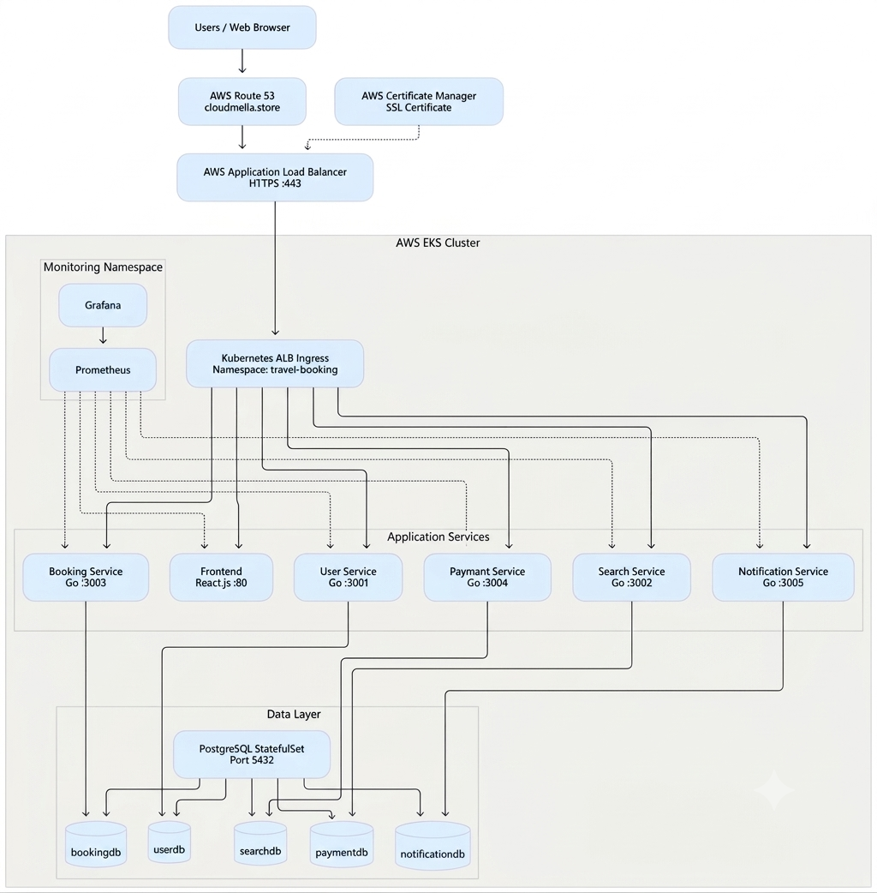

# MicroService Travel Booking Website — Setup Guide

TravelBooking is a cloud-native microservices-based travel application where users can search for flights and hotels, make bookings, and process payments — similar to MakeMyTrip or Booking.com.

The main focus of this project is to showcase an end-to-end DevOps and DevSecOps lifecycle on Amazon Web Services (AWS), using services such as Amazon EKS, EC2, IAM, EBS, and Route 53, along with tools like Jenkins, Docker, SonarQube, Trivy, Prometheus, Grafana, and Argo CD.

> **Note:** Replace all `<VERSION>`, `<your-server-ip>`, `<jenkins-ip>`, `<sonar-ip-address>`, and similar placeholders with your actual values.

# Architecture Diagram



## End-to-End Microservices CI/CD & Deployment Flow
```bash
                              Developer
                                  |
                                  ▼
                         Initial Code Push
                                  |
                                  ▼
                         GitHub Main Branch
                                  |
                                  ▼
                    Jenkins CI/CD (6 Separate Jobs)
                                  |
       ┌──────────────────────────┼──────────────────────────┐
       |                          |                          |
       ▼                          ▼                          ▼
 Frontend Pipeline          User Service Pipeline      Search Service Pipeline
 (React.js / Node.js)       (Go / Port 3001)            (Go / Port 3002)
       |                          |                          |
       └──────────────────────────┼──────────────────────────┘
                                  |
       ┌──────────────────────────┼──────────────────────────┐
       |                          |                          |
       ▼                          ▼                          ▼
 Booking Service Pipeline   Payment Service Pipeline   Notification Pipeline
 (Go / Port 3003)           (Go / Port 3004)            (Go / Port 3005)
       |                          |                          |
       └──────────────────────────┼──────────────────────────┘
                                  |
                                  ▼
                     SERVICE-SPECIFIC CI PIPELINE
                                  |
                                  ▼
                         Checkout Source Code
                                  |
                                  ▼
                    Dependency Installation / Download
                         (NPM / Go Modules)
                                  |
                                  ▼
                            Unit Testing
                         (NPM / Go Test)
                                  |
                                  ▼
                       SonarQube Code Analysis
                                  |
                                  ▼
                            Quality Gate
                                  |
                                  ▼
                       Trivy File System Scan
                                  |
                                  ▼
                        Docker Image Build
                                  |
                                  ▼
                        Trivy Image Scan
                                  |
                                  ▼
                      Push Image to Docker Hub
                                  |
                                  ▼
                   Update Kubernetes Image Tag
                       (Service Deployment YAML)
                                  |
                                  ▼
                      Push Updated YAML to GitHub
                                  |
                                  ▼
                           Argo CD (GitOps)
                                  |
                                  ▼
                         AWS EKS Cluster
                                  |
                                  ▼
                     Kubernetes Deployments
                                  |
          ┌──────────────────────┼──────────────────────┐
          |                      |                      |
          ▼                      ▼                      ▼
    Frontend Pods          Go Microservices       PostgreSQL StatefulSet
                           ┌────────────────┐              |
                           │ User Service   │              ├── userdb
                           │ Search Service │              ├── searchdb
                           │ Booking Service│              ├── bookingdb
                           │ Payment Service│              ├── paymentdb
                           │ Notification   │              └── notificationdb
                           └────────────────┘
                                  |
                                  |
                                  ▼
                     AWS ALB Ingress Controller
                                  |
                    ┌─────────────┴─────────────┐
                    |                           |
                    ▼                           ▼
                Route 53                  AWS Certificate
                (DNS)                     Manager (ACM)
                    |                           |
                    └─────────────┬─────────────┘
                                  |
                                  ▼
                         HTTPS (SSL/TLS)
                                  |
                                  ▼
                         cloudmella.store
                                  |
                                  ▼
                    Travel Booking Application
                                  |
                                  ▼
                       Prometheus + Grafana
                            (Monitoring)
```

## Microservices
|Service | Language |	Port |	Database |	Purpose|
| :---   | :---     | :--- |  :---     |  :---   |    
|Frontend |	React.js |	80 |	-	 |User interface|
|User Service |	Go |	3001 |	userdb |	Registration, login, JWT auth |
|Search Service |	Go |	3002 |	searchdb |	Flight & hotel search|
|Booking Service |	Go |	3003 |	bookingdb |	Create & manage bookings|
|Payment Service |	Go |	3004 |	paymentdb |	Payment processing|
|Notification Service |	Go |	3005 |	notificationdb |	Booking notifications|
|PostgreSQL |	-	 |5432 |	5 DBs |	Data storage (StatefulSet)|

## Project Structure

```bash
MicroService-TravelBooking/
│
├── Jenkinsfile/
│   │
│   ├── frontend
│   ├── userservice
│   ├── searchservice
│   ├── bookingservice
│   ├── paymentservice
│   └── notificationservice

|
k8s/
│
├── database/
│   ├── postgres-initdb-configmap.yaml
│   ├── postgres-pvc.yaml
│   ├── postgres-secret.yaml
│   ├── postgres-service.yaml
│   ├── postgres-statefulset.yaml
│   └── postgres-storageclass.yaml
│
├── infrastructure/
│   ├── ingress.yaml
│   └── namespace.yaml
│
└── microservices/
│    │
│    ├── booking-service/
│    │   ├── booking-service-configmap.yaml
│    │   ├── booking-service-deployment.yaml
│    │   ├── booking-service-secret.yaml
│    │   └── booking-service-service.yaml
│    │
│    ├── frontend/
│    │   ├── frontend-deployment.yaml
│    │   └── frontend-service.yaml
│    │
│    ├── notification-service/
│    │   ├── notification-service-configmap.yaml
│    │   ├── notification-service-deployment.yaml
│    │   ├── notification-service-secret.yaml
│    │   └── notification-service-service.yaml
│    │
│    ├── payment-service/
│    │   ├── payment-service-configmap.yaml
│    │   ├── payment-service-deployment.yaml
│    │   ├── payment-service-secret.yaml
│    │   └── payment-service-service.yaml
│    │
│    ├── search-service/
│    │   ├── search-service-configmap.yaml
│    │   ├── search-service-deployment.yaml
│    │   ├── search-service-secret.yaml
│    │   └── search-service-service.yaml
│    │
│    └── user-service/
│        ├── user-service-configmap.yaml
│        ├── user-service-deployment.yaml
│        ├── user-service-secret.yaml
│        └── user-service-service.yaml
│
├── microservicecode/
│   │
│   ├── frontend/               # React.js frontend
│   ├── user-service/           # Go — user management & JWT auth
│   ├── search-service/         # Go — flight & hotel search with Redis cache 
│   ├── booking-service/        # Go — booking management
│   ├── payment-service/        # Go — payment processing
│   └── notification-service/   # Go — notifications
|
└── README.md

```

## Table of Contents

* [Prerequisites](#prerequisites)
* [System Update & Common Packages](#system-update--common-packages)
* [Java](#java)
* [Jenkins](#jenkins)
* [Docker](#docker)
* [Trivy](#trivy-vulnerability-scanner)
* [Jenkins Plugins to Install](#jenkins-plugins-to-install)
* [Jenkins Credentials to Store](#jenkins-credentials-to-store)
* [Jenkins Tools Configuration](#jenkins-tools-configuration)
* [Jenkins System Configuration](#jenkins-system-configuration)
* [EKS ALB Ingress Kubernetes Setup Guide](#eks-alb-ingress-kubernetes-setup-guide)
* [Prometheus, Node Exporter & Grafana Setup Guide](#prometheus-node-exporter-grafana-setup-guide)
* [Installing Argo CD](#installing-argo-cd)

---

### Ports to Enable in Security Group

| Service | Port |
| :--- | :--- |
| HTTP | 80 |
| HTTPS | 443 |
| SSH | 22 |
| Jenkins | 8080 |
| SonarQube | 9000 |
| Prometheus | 9090 |
| Node Exporter | 9100 |
| Grafana | 3000 |
---

## Prerequisites
---

This guide assumes an Ubuntu/Debian-like environment and sudo privileges.

---
## System Update & Common Packages

```bash
sudo apt update -y
sudo apt upgrade -y
```
**First**: refresh the package list

**Second**: install available updates

```bash
# Common tools

sudo apt install -y bash-completion wget git zip unzip curl jq net-tools build-essential ca-certificates apt-transport-https gnupg fontconfig
```
---
**Reload bash completion if needed:**
```bash
source /etc/bash_completion
```
`bash-completion` is a package that makes TAB auto-completion work better in the Linux terminal. After installing bash-completion you can press TAB button for auto-completion. For example, cd /etc/apa + TAB → cd /etc/apache2/.

# Install latest Git:

```bash
sudo add-apt-repository ppa:git-core/ppa
sudo apt update
sudo apt install git -y
```

---

# Java
---
Install OpenJDK 21:

```bash
# OR OpenJDK 21
sudo apt install -y openjdk-21-jdk
```
Verify:
```bash
java --version
```
```ssh
readlink -f $(which java)
/usr/lib/jvm/java-21-openjdk-amd64/bin/java
```
**Note:** In the jenkins tool configuration we need to use in Java_Home= /usr/lib/jvm/java-21-openjdk-amd64

---
# Jenkins
Official docs: [https://www.jenkins.io/doc/book/installing/linux/](https://www.jenkins.io/doc/book/installing/linux/)
```bash
sudo wget -O /etc/apt/keyrings/jenkins-keyring.asc \
  https://pkg.jenkins.io/debian-stable/jenkins.io-2026.key
echo "deb [signed-by=/etc/apt/keyrings/jenkins-keyring.asc]" \
  https://pkg.jenkins.io/debian-stable binary/ | sudo tee \
  /etc/apt/sources.list.d/jenkins.list > /dev/null
```
```bash
sudo apt update
sudo apt install jenkins
sudo systemctl enable --now jenkins
sudo systemctl start jenkins
sudo systemctl status jenkins
```
Initial admin password:
```bash
sudo cat /var/lib/jenkins/secrets/initialAdminPassword
```
Then open: [http://your-server-ip:8080](http://your-server-ip:8080)

**Note**: Jenkins requires a compatible Java runtime. Check the Jenkins documentation for supported Java versions.

---
# Docker
Official docs: [https://docs.docker.com/engine/install/ubuntu/](https://docs.docker.com/engine/install/ubuntu/)
```bash
# Add Docker's official GPG key:
sudo apt update
sudo apt install ca-certificates curl
sudo install -m 0755 -d /etc/apt/keyrings
sudo curl -fsSL https://download.docker.com/linux/ubuntu/gpg -o /etc/apt/keyrings/docker.asc
sudo chmod a+r /etc/apt/keyrings/docker.asc

# Add the repository to Apt sources:
sudo tee /etc/apt/sources.list.d/docker.sources <<EOF
Types: deb
URIs: https://download.docker.com/linux/ubuntu
Suites: $(. /etc/os-release && echo "${UBUNTU_CODENAME:-$VERSION_CODENAME}")
Components: stable
Architectures: $(dpkg --print-architecture)
Signed-By: /etc/apt/keyrings/docker.asc
EOF

sudo apt update

# Install the Docker packages.
sudo apt-get install -y docker-ce docker-ce-cli containerd.io docker-buildx-plugin docker-compose-plugin

# Add user to docker group (log out / in or newgrp to apply)
sudo usermod -aG docker $USER
newgrp docker
docker ps
```

If Jenkins needs Docker access:

```bash
sudo usermod -aG docker jenkins
sudo systemctl restart jenkins
```

Check Docker status:
```bash
sudo systemctl status docker
```
---

# Trivy (Vulnerability Scanner)
Docs: [https://trivy.dev/docs/latest/getting-started/installation/](https://trivy.dev/docs/latest/getting-started/installation/)
```bash
sudo apt-get install wget apt-transport-https gnupg lsb-release
wget -qO - https://aquasecurity.github.io/trivy-repo/deb/public.key | sudo apt-key add -
echo deb https://aquasecurity.github.io/trivy-repo/deb $(lsb_release -sc) main | sudo tee -a /etc/apt/sources.list.d/trivy.list
sudo apt-get update
sudo apt-get install -y trivy


trivy --version
```
---

# Jenkins Plugins to Install
* Email Extension Template Plugin
* Pipeline: Stage View Plugin
* SonarQube Scanner for Jenkins
* Prometheus metrics plugin
* Docker API Plugin
* Docker Commons Plugin
* Docker Pipeline
* Docker plugin
* docker-build-step

# SonarQube Docker Container Run for Analysis

```bash
docker run -d --name sonarqube \
  -p 9000:9000 \
  -v sonarqube_data:/opt/sonarqube/data \
  -v sonarqube_logs:/opt/sonarqube/logs \
  -v sonarqube_extensions:/opt/sonarqube/extensions \
  sonarqube:lts-community
```
# Jenkins Credentials to Store
| Purpose | ID | Type | Notes
| :--- | :--- | :--- | :--- |
|Email | email-creds | Username/app | App Password |	
SonarQube | sonar-token | Secret text | From SonarQube application
Docker Hub | dockerhub-creds | Secret text | From your Docker Hub profile
GitHub | github-creds | Username/app | git hub token 

Webhook example:
`http://<jenkins-ip>:8080/sonarqube-webhook/`

**Note:** Create the webhook in the SonarQube

# Jenkins Tools Configuration
* JDK
* SonarQube Scanner installations [sonar-scanner]
* Docker installations

# Jenkins System Configuration
**SonarQube servers:**
* Name: sonar-server
* URL: http://:9000
* Credentials: Add from Jenkins credentials

# Extended E-mail Notification:
* SMTP server: smtp.gmail.com
* SMTP Port: 465
* Use SSL
* Default user e-mail suffix: @gmail.com

# E-mail Notification:
* SMTP server: smtp.gmail.com
* Default user e-mail suffix: @gmail.com
* Use SMTP Authentication: Yes
* User Name: example@gmail.com
* Password: Use credentials
* Use TLS: Yes
* SMTP Port: 587
* Reply-To Address: example@gmail.com

---

## Now See the configuration pipeline of the jenkins
## EKS ALB Ingress Kubernetes Setup Guide 
## EKS cluster setup and ALB Ingress Kubernetes Setup Guide

This guide covers the installation and setup for AWS CLI, kubectl, eksctl, and helm, and creating/configuring an EKS cluster with AWS Load Balancer Controller.

---
# 1. AWS CLI Installation
Refer: [AWS CLI installation guide](https://docs.aws.amazon.com/cli/latest/userguide/getting-started-install.html)
```bash
sudo apt install -y unzip
curl "https://awscli.amazonaws.com/awscli-exe-linux-x86_64.zip" -o "awscliv2.zip"
unzip awscliv2.zip
sudo ./aws/install
```
---
# 2. kubectl Installation
Refer: [kubectl Installation Guide](https://kubernetes.io/docs/tasks/tools/install-kubectl-linux/)
```bash
sudo apt-get update
# apt-transport-https may be a dummy package; if so, you can skip that package
sudo apt-get install -y apt-transport-https ca-certificates curl gnupg

# If the folder `/etc/apt/keyrings` does not exist, it should be created before the curl command, read the note below.
# sudo mkdir -p -m 755 /etc/apt/keyrings
curl -fsSL https://pkgs.k8s.io/core:/stable:/v1.33/deb/Release.key | sudo gpg --dearmor -o /etc/apt/keyrings/kubernetes-apt-keyring.gpg
sudo chmod 644 /etc/apt/keyrings/kubernetes-apt-keyring.gpg # allow unprivileged APT programs to read this keyring

# This overwrites any existing configuration in /etc/apt/sources.list.d/kubernetes.list
echo 'deb [signed-by=/etc/apt/keyrings/kubernetes-apt-keyring.gpg] https://pkgs.k8s.io/core:/stable:/v1.33/deb/ /' | sudo tee /etc/apt/sources.list.d/kubernetes.list
sudo chmod 644 /etc/apt/sources.list.d/kubernetes.list   # helps tools such as command-not-found to work correctly

sudo apt-get update
sudo apt-get install -y kubectl bash-completion

# Enable kubectl auto-completion
echo 'source <(kubectl completion bash)' >> ~/.bashrc
echo 'alias k=kubectl' >> ~/.bashrc
echo 'complete -F __start_kubectl k' >> ~/.bashrc

# Apply changes immediately
source ~/.bashrc
```
---
# 3. eksctl Installation
Refer: [eksctl Installation Guide](https://docs.aws.amazon.com/eks/latest/eksctl/installation.html)
```bash
# for ARM systems, set ARCH to: `arm64`, `armv6` or `armv7`
ARCH=amd64
PLATFORM=$(uname -s)_$ARCH

curl -sLO "https://github.com/eksctl-io/eksctl/releases/latest/download/eksctl_$PLATFORM.tar.gz"

# (Optional) Verify checksum
curl -sL "https://github.com/eksctl-io/eksctl/releases/latest/download/eksctl_checksums.txt" | grep $PLATFORM | sha256sum --check

tar -xzf eksctl_$PLATFORM.tar.gz -C /tmp && rm eksctl_$PLATFORM.tar.gz

sudo install -m 0755 /tmp/eksctl /usr/local/bin && rm /tmp/eksctl

# Install bash completion
sudo apt-get install -y bash-completion

# Enable eksctl auto-completion
echo 'source <(eksctl completion bash)' >> ~/.bashrc
echo 'alias e=eksctl' >> ~/.bashrc
echo 'complete -F __start_eksctl e' >> ~/.bashrc

# Apply changes immediately
source ~/.bashrc
```
---
# 4. Helm Installation
Refer: [Helm Installation Guide](https://helm.sh/docs/intro/install/)
```bash
sudo apt-get install curl gpg apt-transport-https --yes
curl -fsSL https://packages.buildkite.com/helm-linux/helm-debian/gpgkey | gpg --dearmor | sudo tee /usr/share/keyrings/helm.gpg > /dev/null
echo "deb [signed-by=/usr/share/keyrings/helm.gpg] https://packages.buildkite.com/helm-linux/helm-debian/any/ any main" | sudo tee /etc/apt/sources.list.d/helm-stable-debian.list
sudo apt-get update
sudo apt-get install helm bash-completion

# Enable Helm auto-completion
echo 'source <(helm completion bash)' >> ~/.bashrc
echo 'alias h=helm' >> ~/.bashrc
echo 'complete -F __start_helm h' >> ~/.bashrc

# Apply changes immediately
source ~/.bashrc
```

# 5. AWS CLI Configuration
```bash
aws configure
aws configure list
```
Create the User and apply the policy on it "AdministratorAccess"

# 6. Create EKS Cluster and Nodegroup (Try-This)
```bash
sudo eksctl create cluster --name chetan-cluster2026 --region us-west-2 --version 1.33 --node-type t3.medium --nodes 2  --nodes-min 2 --nodes-max 4 --node-volume-size 30 --zones us-west-2a,us-west-2b
```

# 7. Update kubeconfig
```bash
sudo aws eks update-kubeconfig --name chetan-cluster2026 --region us-west-2
```

# 8. Associate IAM OIDC Provider
```bash
sudo eksctl utils associate-iam-oidc-provider --cluster chetan-cluster2026 --approve
```
████████████████████████████████████████████████████████████████████████████████████████

# Install and Configure AWS Load Balancer Controller on Amazon EKS


**1. Create IAM Policy for AWS Load Balancer Controller**

New policy link: [AWS EKS LBC Policy](https://docs.aws.amazon.com/eks/latest/userguide/lbc-manifest.html)

```bash
sudo curl -O https://raw.githubusercontent.com/kubernetes-sigs/aws-load-balancer-controller/v2.13.3/docs/install/iam_policy.json

sudo aws iam create-policy \
  --policy-name AWSLoadBalancerControllerIAMPolicy \
  --policy-document file://iam_policy.json
```

**2. Create IAM Service Account**

Replace <ACCOUNT_ID> with your AWS account ID.
```bash
sudo eksctl create iamserviceaccount \
  --cluster=chetan-cluster2026 \
  --namespace=kube-system \
  --name=aws-load-balancer-controller \
  --attach-policy-arn=arn:aws:iam::<ACCOUNT_ID>:policy/AWSLoadBalancerControllerIAMPolicy \
  --override-existing-serviceaccounts \
  --region us-west-2 \
  --approve
```

**3. Install AWS Load Balancer Controller via Helm**
```bash
helm repo add eks https://aws.github.io/eks-charts
helm repo update eks

helm install aws-load-balancer-controller eks/aws-load-balancer-controller -n kube-system \
  --set clusterName=chetan-cluster2026 \
  --set serviceAccount.create=false \
  --set serviceAccount.name=aws-load-balancer-controller \
  --set region=us-west-2 \
  --version 1.13.3
```

**Optional:** List available versions:
```bash
helm search repo eks/aws-load-balancer-controller --versions
helm list -A
```

**Verify installation:**
```bash
kubectl get deployment -n kube-system aws-load-balancer-controller
```
████████████████████████████████████████████████████████████████████████████████████████

# Prometheus, Node Exporter, Grafana Setup Guide

## Prometheus Installation Guide 
This guide walks you through installing Prometheus on a Linux-based AMD64 system such as Intel or AMD x86_64 servers and desktops.

**Official downloads**: [https://prometheus.io/download/](https://prometheus.io/download/)

**Step 1: Create Prometheus User and Folders**

Create a dedicated non-login user and the necessary directories for configuration and data.
```bash
sudo useradd --no-create-home --shell /bin/false prometheus
sudo mkdir -p /etc/prometheus /var/lib/prometheus
sudo chown prometheus:prometheus /var/lib/prometheus
```
**Step 2: Download and Extract Prometheus**

Fetch the AMD64 binary archive and unpack it.
```bash
cd /tmp
wget https://github.com/prometheus/prometheus/releases/download/v3.4.1/prometheus-3.4.1.linux-amd64.tar.gz
tar -xvf prometheus-3.4.1.linux-amd64.tar.gz
cd prometheus-3.4.1.linux-amd64
```
**Step 3: Install Binaries and Example Configuration**

Move Prometheus files into system-wide locations and prepare configuration folders.
```bash
sudo mv prometheus promtool /usr/local/bin/
sudo chmod +x /usr/local/bin/prometheus /usr/local/bin/promtool
sudo mv prometheus.yml /etc/prometheus/
sudo mkdir -p /etc/prometheus/consoles /etc/prometheus/console_libraries
sudo chown -R prometheus:prometheus /etc/prometheus
```
**Step 4: Create systemd Service**

Create a systemd service file so Prometheus can run in the background and start on boot.
```bash
sudo vim /etc/systemd/system/prometheus.service
```
Paste the following into the file:
```bash
[Unit]
Description=Prometheus Monitoring
Wants=network-online.target
After=network-online.target

[Service]
User=prometheus
Group=prometheus
Type=simple
ExecStart=/usr/local/bin/prometheus \
  --config.file=/etc/prometheus/prometheus.yml \
  --storage.tsdb.path=/var/lib/prometheus \
  --web.console.templates=/etc/prometheus/consoles \
  --web.console.libraries=/etc/prometheus/console_libraries

[Install]
WantedBy=multi-user.target
```
Save and close the file.

**Step 5: Start and Enable Prometheus**

Enable the Prometheus service so it starts on boot and run it now.
```bash
sudo systemctl daemon-reload
sudo systemctl start prometheus
sudo systemctl enable prometheus
```
**Step 6: Verify the Setup**
Open your browser and navigate to:

`http://ip-address:9090`

You should see the Prometheus dashboard running.

**Step 7: Prometheus scrape config:**

Add to `sudo vim /etc/prometheus/prometheus.yml`:
```bash
  - job_name: "node_exporter"
    static_configs:
      - targets: ["<ip-address>:9100"]

  - job_name: "jenkins"
    metrics_path: /prometheus
    static_configs:
      - targets: ["<jenkins-ip>:8080"]
```
     
Validate config:
```bash
promtool check config /etc/prometheus/prometheus.yml
sudo systemctl restart prometheus
```
---

## Node Exporter Installation Guide (Linux AMD64)
This guide walks you through installing Node Exporter on a Linux-based AMD64 system such as x86_64 servers or virtual machines.

**Docs**: [https://prometheus.io/download/#node_exporter](https://prometheus.io/download/#node_exporter)

**Step 1: Create Node Exporter User**

Create a dedicated non-login user for running the exporter.
```bash
sudo useradd --no-create-home --shell /bin/false node_exporter
```

**Step 2: Download and Extract Node Exporter**

Fetch the AMD64 binary archive and unpack it.
```bash
cd /tmp
wget https://github.com/prometheus/node_exporter/releases/download/v1.9.1/node_exporter-1.9.1.linux-amd64.tar.gz
tar -xvf node_exporter-1.9.1.linux-amd64.tar.gz
cd node_exporter-1.9.1.linux-amd64
```
**Step 3: Install Binary**

Move the binary to your system's executable path and assign ownership.
```bash
sudo mv node_exporter /usr/local/bin/
sudo chown node_exporter:node_exporter /usr/local/bin/node_exporter
```
**Step 4: Create systemd Service**

Create a systemd service to run Node Exporter as a background process.
```bash
sudo vim /etc/systemd/system/node_exporter.service
```
Paste the following content:
```bash
[Unit]
Description=Node Exporter
Wants=network-online.target
After=network-online.target

[Service]
User=node_exporter
Group=node_exporter
Type=simple
ExecStart=/usr/local/bin/node_exporter

[Install]
WantedBy=multi-user.target
```
Save and close the file.

**Step 5: Start and Enable Node Exporter**

Start the service and enable it at boot.
```bash
sudo systemctl daemon-reload
sudo systemctl start node_exporter
sudo systemctl enable node_exporter
```
**Step 6: Verify the Setup**
Open your browser and go to:

`http://ip-address:9100/metrics`

You should see a live stream of metrics generated by Node Exporter.

---

## Grafana Installation Guide via APT Repository
This guide walks you through installing Grafana on a Ubuntu Linux via APT Repository.

**Docs**: [https://grafana.com/docs/grafana/latest/setup-grafana/installation/debian/](https://grafana.com/docs/grafana/latest/setup-grafana/installation/debian/)

**1. Add the Grafana APT key**
```bash
sudo apt-get install -y apt-transport-https software-properties-common wget
wget -q -O - https://apt.grafana.com/gpg.key | gpg --dearmor | sudo tee /etc/apt/keyrings/grafana.gpg > /dev/null
```
**2. Add the Grafana repository**
```bash
echo "deb [signed-by=/etc/apt/keyrings/grafana.gpg] https://apt.grafana.com stable main" | sudo tee -a /etc/apt/sources.list.d/grafana.list
```
**3. Update package list**
```bash
sudo apt-get update
```
**4. Install Grafana**
```bash
sudo apt-get install -y grafana
```
**5. Start and enable Grafana**
```bash
sudo systemctl start grafana-server
sudo systemctl enable grafana-server
```
Grafana is now running as a systemd service and will auto-start on boot.

**6. Access Grafana**
Open your browser and visit:
```bash
http://ip-address:3000
```
Default credentials:

Username: ` admin `

Password: ` admin `  (you'll be prompted to change it at first login)

Create the Prometheus Datasource: [http://promethues-ip:9090](http://promethues-ip:9090)

---

## Connect Grafana to Prometheus Step-by-Step
Great — let’s wire up Grafana with Prometheus so you can start visualizing all those juicy metrics!

**1. Log in to Grafana**
Go to http://localhost:3000 in your browser.
Default credentials:

* **Username**: admin
* **Password**: admin (you'll be asked to change it if you didn't already)

**2. Add Prometheus as a Data Source**
1. In the left sidebar, click ⚙️ **“Connections” > “Add new connection”**
2. Click **“Search Prometheus in Data sources”**
3. Choose **Prometheus** from the list

**3. Configure Prometheus Connection**
In the **Connection** section:

* **Prometheus server URL**
```bash
http://localhost:9090
```
* Leave all other settings as default (for a local setup)

Click **“Save & test”** — you should get a green checkmark ✅ confirming it's working.

**4. Create Your First Dashboard Panel**
1. Click the + icon in the sidebar → choose **“Dashboards”**

2. Click **“NEW”**

3. Enter a query like:
```bash
rate(prometheus_engine_query_duration_seconds[1m])
```
4. Choose a visualization type: **graph, gauge**, etc.
5. Click **Apply**

Boom — you’ve got real data visualized from Prometheus in Grafana!

---

# Dashboard id
* Node_Exporter 1860 Docs: https://grafana.com/grafana/dashboards/1860-node-exporter-full/
* jenkins 9964 Docs: https://grafana.com/grafana/dashboards/9964-jenkins-performance-and-health-overview/
* kubernetes 17119 Docs: https://grafana.com/grafana/dashboards/18283-kubernetes-dashboard/


████████████████████████████████████████████████████████████████████████████████████████

# Installing Argo CD on the eks cluster
Docs: [https://www.eksworkshop.com/docs/automation/gitops/argocd/access_argocd](https://www.eksworkshop.com/docs/automation/gitops/argocd/access_argocd)

Docs: [https://github.com/argoproj/argo-helm](https://github.com/argoproj/argo-helm)

# Argocd installation via helm chart
```bash
sudo helm repo add argo https://argoproj.github.io/argo-helm
sudo helm repo update
```
```bash
sudo kubectl create namespace argocd 
sudo helm install argocd argo/argo-cd --namespace argocd
sudo kubectl get all -n argocd 
sudo kubectl patch svc argocd-server -n argocd -p '{"spec": {"type": "LoadBalancer"}}' 
```
# Another way to get the loadbalancer of the argocd alb url
```bash
sudo apt install jq -y

sudo kubectl get svc argocd-server -n argocd -o json | jq --raw-output '.status.loadBalancer.ingress[0].hostname'
```
  Username: admin
```bash
sudo kubectl -n argocd get secret argocd-initial-admin-secret -o jsonpath="{.data.password}" | base64 -d
```
---

# Delete the EKS Cluster

```bash
eksctl delete cluster --name chetan-cluster2026 --region us-west-2 
```
# Screenshots

